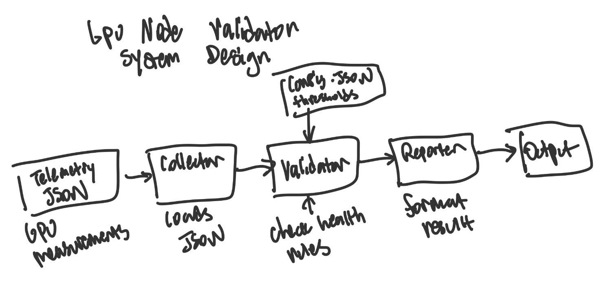
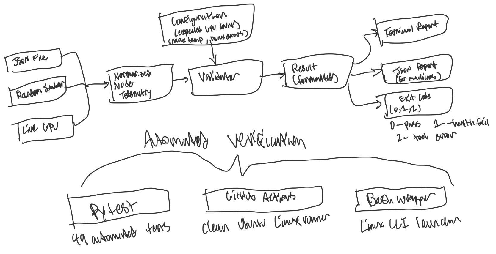

# GPU Node Validator

A Python command-line tool that validates fixture-based JSON, randomly generated, or live NVIDIA GPU telemetry against configurable health rules. It produces human-readable output, optionally writes a structured JSON report, and returns an exit code suitable for automation and CI.

Live collection uses the public `nvidia-smi` utility. The collector is separated from validation so another hardware source, such as AMD SMI on compatible hardware, can be added without replacing the validation engine. This project does not reproduce AMD internal tools.

## System design evolution

### Original MVP design

The first version used one direct pipeline: load GPU telemetry from JSON, validate it against configured health thresholds, and format the result for output.



### Current system design

The current version preserves the same collection-to-validation-to-reporting pipeline while supporting JSON fixtures, randomized simulation, and live NVIDIA telemetry through a shared normalized data format. Pytest, GitHub Actions, and the Bash wrapper support automated verification and Linux execution.



## Demo videos

| Demo | Description |
| --- | --- |
| https://github.com/user-attachments/assets/b6b1600f-7d98-42ba-b152-d058bfee60f1 | Collects and validates telemetry from a physical NVIDIA GPU using `nvidia-smi`. |
| https://github.com/user-attachments/assets/860ec519-3b6c-4a51-b93a-a56b6876216d | Generates simulated multi-GPU telemetry and reports the detected health failures. |
| https://github.com/user-attachments/assets/86c6bb39-ae80-49e2-91b4-838b0642c7a1 | Runs the complete automated test suite. |


## Setup


Create and activate a virtual environment, then install the test dependency:

```powershell
py -m venv .venv
& ".\.venv\Scripts\Activate.ps1"
python -m pip install -r requirements.txt
```

## Usage

Run a healthy example:

```powershell
python main.py --input samples/healthy_node.json --config config.json
```

Run an unhealthy example:

```powershell
python main.py --input samples/unhealthy_node.json --config config.json
```

Collect and validate live NVIDIA telemetry:

```powershell
python main.py --live-nvidia --config config.nvidia.json
```

Save a live report:

```powershell
python main.py `
    --live-nvidia `
    --config config.nvidia.json `
    --output reports/live-nvidia.json
```

The live configuration expects one NVIDIA GPU because `nvidia-smi` does not enumerate an Intel integrated GPU.

Generate eight random GPUs using the simulation configuration:

```powershell
python main.py --simulate --config config.simulation.json
```

Every unseeded run creates different telemetry. The terminal and JSON report show the generated seed. Reuse it to reproduce the same GPU data:

```powershell
python main.py `
    --simulate `
    --config config.simulation.json `
    --seed 2026 `
    --output reports/simulation-2026.json
```

Override the number of generated GPUs:

```powershell
python main.py `
    --simulate `
    --config config.simulation.json `
    --gpu-count 100 `
    --output reports/simulation-100-gpus.json
```

If `--gpu-count` differs from `expected_gpu_count`, the validator intentionally reports a GPU-count failure. The simulator permits up to 1,000 GPUs per run.

Write a structured JSON report:

```powershell
python main.py `
    --input samples/healthy_node.json `
    --config config.json `
    --output reports/healthy.json
```

Show all CLI options:

```powershell
python main.py --help
```

## Exit codes

| Code | Meaning |
| --- | --- |
| `0` | Validation completed and the node passed |
| `1` | Validation completed and the node failed |
| `2` | The tool could not load/collect inputs or write the requested report |

## Tests

Run the complete test suite:

```powershell
python -m pytest -v
```

Tests cover JSON loading, reproducible random simulation, mocked NVIDIA SMI collection, configuration validation, GPU health rules, CLI integration, report output, and exit codes. CI uses mocked NVIDIA output because a standard GitHub-hosted runner does not provide this laptop's GPU.

## Bash wrapper

From Linux or WSL, run the defaults:

```bash
bash scripts/run_validation.sh
```

Or provide input, configuration, and output paths:

```bash
bash scripts/run_validation.sh \
    samples/unhealthy_node.json \
    config.json \
    reports/unhealthy.json
```

The wrapper uses `python3` by default. Set `PYTHON_BIN` to choose a different interpreter.

## Continuous integration

GitHub Actions runs the full pytest suite and smoke-tests both the CLI and Bash wrapper on every push and pull request.

## Current validation rules

- GPU count must match `expected_gpu_count`.
- Every GPU must contain `gpu_id`, `detected`, `temperature_c`, and `error_count`.
- Every GPU must be detected.
- Temperature must not exceed `max_temperature_c`.
- Error count must not exceed `max_error_count`.
- Missing or invalid metrics fail validation.
- When a hardware source cannot provide an error counter, the report warns that the rule was skipped instead of treating the unknown value as zero.
