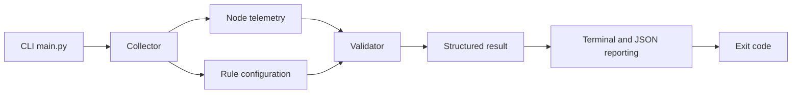

# GPU Node Validator

A Python command-line tool that validates simulated GPU-node telemetry against configurable health rules. It produces human-readable output, optionally writes a structured JSON report, and returns an exit code suitable for automation and CI.

This project uses simulated telemetry. It does not query real GPU hardware or reproduce AMD internal tools.

## Architecture



- `main.py` parses arguments and coordinates the workflow.
- `collector.py` loads and performs basic structural checks on JSON inputs.
- `validator.py` applies configurable GPU health rules.
- `reporter.py` prints results and writes JSON reports.

## Setup

Create and activate a virtual environment, then install the test dependency:

```powershell
py -m venv .venv
& ".\.venv\Scripts\Activate.ps1"
python -m pip install -r requirements.txt
```

## Usage

Run a healthy example:

```powershell
python main.py --input samples/healthy_node.json --config config.json
```

Run an unhealthy example:

```powershell
python main.py --input samples/unhealthy_node.json --config config.json
```

Write a structured JSON report:

```powershell
python main.py `
    --input samples/healthy_node.json `
    --config config.json `
    --output reports/healthy.json
```

Show all CLI options:

```powershell
python main.py --help
```

## Exit codes

| Code | Meaning |
| --- | --- |
| `0` | Validation completed and the node passed |
| `1` | Validation completed and the node failed |
| `2` | The tool could not load inputs or write the requested report |

## Tests

Run the complete test suite:

```powershell
python -m pytest -v
```

Tests cover input loading, configuration validation, GPU health rules, CLI integration, report output, and exit codes.

## Bash wrapper

From Linux or WSL, run the defaults:

```bash
bash scripts/run_validation.sh
```

Or provide input, configuration, and output paths:

```bash
bash scripts/run_validation.sh \
    samples/unhealthy_node.json \
    config.json \
    reports/unhealthy.json
```

The wrapper uses `python3` by default. Set `PYTHON_BIN` to choose a different interpreter.

## Continuous integration

GitHub Actions runs the full pytest suite and smoke-tests both the CLI and Bash wrapper on every push and pull request.

## Current validation rules

- GPU count must match `expected_gpu_count`.
- Every GPU must contain `gpu_id`, `detected`, `temperature_c`, and `error_count`.
- Every GPU must be detected.
- Temperature must not exceed `max_temperature_c`.
- Error count must not exceed `max_error_count`.
- Missing or invalid metrics fail validation.

## Limitations

- Telemetry is loaded from local JSON fixtures rather than GPU hardware.
- Thresholds are demonstration rules, not AMD hardware specifications.
- XML input, distributed polling, dashboards, and anomaly detection are outside the current scope.
